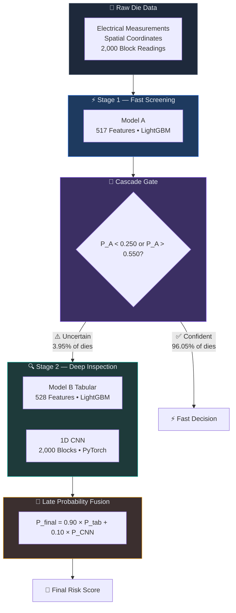
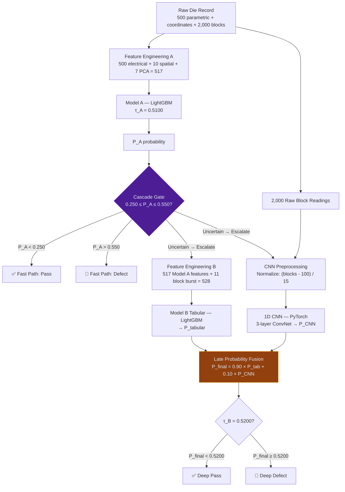
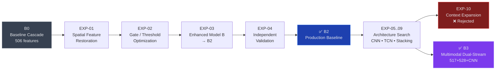
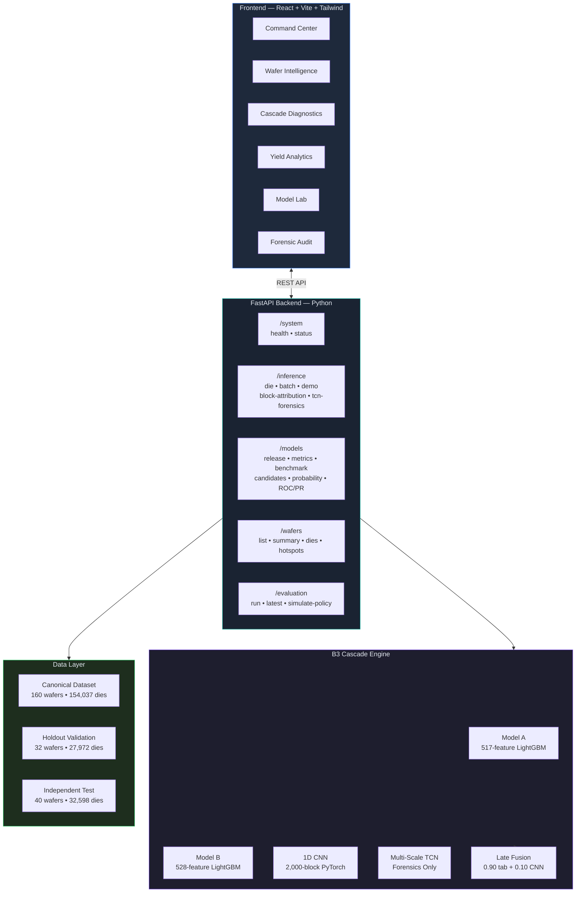

<](https://python.org)
[](https://fastapi.tiangolo.com)
[](https://react.dev)
[](https://lightgbm.readthedocs.io)
[](https://pytorch.org)
[](#testing)
[](#b3-multimodal-architecture)

</div>

---

> **SANDisK CEREBRUM** is an AI-powered semiconductor yield-intelligence platform that combines **selective cascade inference**, **multimodal machine learning**, **spatial wafer analytics**, and **signal-level anomaly detection** to identify potentially defective dies — while avoiding unnecessary expensive secondary computation on dies that don't need it.

---

### Production Highlights — B3 Independent Validation (EXP-04)

| Metric | B3 Production |
|:---|---:|
| Independent dies evaluated | **32,598** |
| Unseen wafers (0% training overlap) | **40** |
| Actual defects | **1,380** |
| Precision | **87.67%** |
| Recall | **37.61%** |
| F1 Score | **0.5264** |
| PR-AUC | **0.5004** |
| ROC-AUC | **0.8270** |
| MCC | **0.5636** |
| Brier Score | **0.0314** |
| ECE (Calibration Error) | **0.0590** |
| Stage-2 escalations | **1,288** |
| Secondary compute bypass | **96.05%** |

> **96.05%** refers to secondary waveform/test & ingestion compute bypass — the fraction of dies where the expensive CNN + Model B analysis is skipped because Model A is sufficiently confident.

---

## Table of Contents

- [The Problem](#the-semiconductor-yield-problem)
- [Why Cerebrum](#why-cerebrum)
- [B3 Multimodal Architecture](#b3-multimodal-architecture)
- [Selective Cascade](#selective-cascade-routing)
- [Feature Engineering](#feature-engineering)
- [Independent Validation](#independent-validation-exp-04)
- [B2 vs B3 Comparison](#b2-vs-b3-head-to-head)
- [Model Evolution](#model-evolution)
- [Platform & Application Modules](#platform--application-modules)
- [System Architecture](#system-architecture)
- [Tech Stack](#technology-stack)
- [Quick Start](#quick-start)
- [API Reference](#api-reference)
- [Project Structure](#project-structure)
- [Model Artifacts](#model-artifacts)
- [Production Governance](#production-governance)
- [Explainability Philosophy](#explainability--human-readable-intelligence)
- [Limitations & Metric Interpretation](#limitations--metric-interpretation)
- [Experiments & Research](#experiments--research-evolution)
- [Team](#team)

---

## The Semiconductor Yield Problem

Modern high-density NAND flash wafers contain **tens of thousands of dies per wafer**. Manufacturing defect rates are inherently low (~3.7–4.2%), creating an extreme class-imbalance challenge:

| Challenge | Impact |
|:---|:---|
| **Over-Testing** | Collecting and analyzing deep 2,000-block sub-die electrical traces across 100% of dies creates severe ATE throughput bottlenecks |
| **Escaped Defects** | Parametric measurements alone miss localized microscopic defects (gate oxide breakdown, pinhole shorts), causing defective dies to reach packaging |
| **False-Scrap Trap** | Naive models produce false alarms on benign dies exhibiting wafer-wide baseline voltage drift, scrapping functional silicon |

Each die can contain:
- **Hundreds of electrical parametric measurements** (e.g. threshold voltages, leakage currents)
- **Spatial and reticle position information** (edge effects, radial gradients)
- **2,000-point block-level signal readings** (sub-die anomaly signatures)
- **Localized cluster patterns** visible only at wafer scale

A single monolithic model is not the best operational solution. Cerebrum therefore separates **fast screening** from **deep inspection**, and only sends uncertain cases to the expensive second stage.

---

## Why Cerebrum

- **Selective Intelligence** — 96.05% of dies are resolved by a fast first-stage model in milliseconds; only 3.95% of uncertain dies proceed to the expensive CNN + tabular deep analysis
- **Multimodal Fusion** — Combines electrical parametric features, spatial wafer topology, and raw 2,000-block signal waveforms through late probability fusion
- **High Precision** — 87.67% precision means fewer false alarms and less functional silicon scrapped
- **Calibrated Risk** — Brier score 0.0314 and ECE 0.0590 provide well-calibrated probability estimates for risk-aware decision-making
- **Full-Stack Platform** — Interactive React dashboard with live cascade diagnostics, spatial wafer maps, forensic signal inspection, and policy simulation

---

## B3 Multimodal Architecture

B3 is a **Multimodal Dual-Stream Cascade** that draws on three independent information sources:

| Source | Representation | Model |
|:---|:---|:---|
| Electrical / parametric measurements | 500 raw features + 7 PCA moment features | Model A (517 features) |
| Spatial / reticle topology | 10 polar + density + edge features | Model A (517 features) |
| Raw 2,000-point block signal | Full waveform input | 1D CNN (independent stream) |
| Block physics summary | 11 burst/spike features | Model B (528 tabular features) |

### High-Level Architecture



### Detailed Inference Flow



### Production Thresholds

| Parameter | Value | Purpose |
|:---|:---|:---|
| `τ_A` | 0.5100 | Model A binary decision threshold |
| Gate lower | 0.250 | Below this → confident pass (fast path) |
| Gate upper | 0.550 | Above this → confident defect (fast path) |
| `τ_B` | 0.5200 | Model B fused-probability decision threshold |
| Tabular weight | 0.90 | Contribution of tabular Model B to fusion |
| CNN weight | 0.10 | Contribution of CNN signal stream to fusion |

> **Key design principle:** The CNN is an **independent signal stream** followed by **late probability fusion**. CNN features are NOT concatenated into Model B's tabular input. The two predictions are blended at the probability level.

---

## Selective Cascade Routing

The cascade gate exists to **spend computation where uncertainty exists**.

### Routing Logic

```
IF P_A < 0.250  →  Fast Path Pass     (high confidence pass)
IF P_A > 0.550  →  Fast Path Defect   (high confidence defect)
IF 0.250 ≤ P_A ≤ 0.550  →  Escalate to Stage 2
```

**Stage 2 (escalated dies only):**
1. Model B tabular analysis (528 features) → `P_tabular`
2. 1D CNN waveform analysis (2,000 blocks) → `P_CNN`
3. Late fusion: `P_final = 0.90 × P_tabular + 0.10 × P_CNN`
4. Decision: `P_final ≥ 0.5200` → Defect

### Why This Architecture?

- **96.05%** of dies are resolved instantly by Model A alone
- Only **1,288 out of 32,598** dies require the expensive CNN + Model B path
- Escalated dies are precisely the ones where Model A was genuinely uncertain
- The CNN adds a **complementary modality** — raw signal patterns that tabular features cannot capture

---

## Feature Engineering

### Model A — 517 Features

| Group | Count | Description |
|:---|:---:|:---|
| Electrical parametric | 500 | Raw `feature_1` through `feature_500` (voltages, currents, leakage) |
| Polar spatial | 3 | `radial_dist`, `sin_theta`, `cos_theta` |
| Multi-scale defect density | 3 | `density_3x3`, `density_5x5`, `density_7x7` (pre-test probe map) |
| Edge / position | 3 | `edge_dist`, `die_row`, `die_col` |
| Wafer-level prior | 1 | `wafer_old_fail_rate` |
| PCA moment features | 7 | `param_max_abs_z`, `param_mean_abs_z`, `param_std_z`, `param_sum_sq_z`, `param_cnt_gt_2sigma`, `param_cnt_gt_3sigma`, `pca_recon_error` |
| **Total** | **517** | |

### Model B Tabular — 528 Features

| Group | Count | Description |
|:---|:---:|:---|
| All Model A features | 517 | Full Model A feature set carried forward |
| Physics-informed block features | 11 | `b_mean`, `b_std`, `b_min`, `b_max`, `b_p95`, `b_p99`, `b_cnt_104`, `b_cnt_106`, `b_max_spike_dev`, `b_first_diff`, `b_longest_run_104` |
| **Total** | **528** | |

### 1D CNN — Raw Signal Stream

| Property | Value |
|:---|:---|
| Input | 2,000 raw block readings per die |
| Normalization | `(blocks - 100.0) / 15.0` |
| Architecture | 3-layer Conv1D (k=15) → BatchNorm → ReLU → MaxPool → AdaptiveAvgPool → 32-dim embedding → sigmoid |
| Receptive field | >100 blocks (detects contiguous anomaly clusters) |
| Output | Independent `P_CNN` probability (NOT concatenated into Model B) |

---

## Independent Validation (EXP-04)

The production B3 model was evaluated on a fully independent test set with **zero wafer overlap** with training data.

### Dataset

| Property | Value |
|:---|---:|
| Total dies | 32,598 |
| Wafers | 40 |
| Actual defects | 1,380 |
| Defect rate | 4.23% |
| Training overlap | 0 wafers |

### Confusion Matrix

|  | Actual Pass | Actual Defect |
|:---|---:|---:|
| **Predicted Pass** | 31,145 | 861 |
| **Predicted Defect** | 73 | 519 |

### Metrics

| Metric | Value |
|:---|---:|
| Accuracy | 97.14% |
| Precision | 87.67% |
| Recall | 37.61% |
| F1 | 0.5264 |
| F2 | 0.4246 |
| MCC | 0.5636 |
| PR-AUC | 0.5004 |
| ROC-AUC | 0.8270 |
| Brier | 0.0314 |
| ECE | 0.0590 |

> The evaluation population contains wafers **not used in training**, providing a stronger indication of generalization to unseen wafer populations than cross-validation on training wafers.

---

## B2 vs B3 Head-to-Head

Both architectures evaluated on the same independent 40-wafer, 32,598-die test set:

| Metric | B2 | B3 | Δ |
|:---|---:|---:|:---|
| Precision | 85.22% | **87.67%** | +2.45 pp |
| Recall | 37.17% | **37.61%** | +0.44 pp |
| F1 | 0.5177 | **0.5264** | +0.0087 |
| F2 | 0.4190 | **0.4246** | +0.0056 |
| MCC | 0.5517 | **0.5636** | +0.0119 |
| PR-AUC | 0.4808 | **0.5004** | +0.0196 |
| ROC-AUC | 0.8078 | **0.8270** | +0.0192 |
| Brier | 0.0442 | **0.0314** | −0.0128 (better) |
| ECE | 0.1214 | **0.0590** | −0.0624 (better) |
| Escalations | 2,028 | **1,288** | **740 fewer** |
| Compute bypass | 93.78% | **96.05%** | +2.27 pp |

**B3 is strictly superior across every metric** — higher precision, higher recall, better calibration, fewer escalations, and greater compute savings.

---

## Model Evolution

The production model evolved through a systematic series of controlled experiments:



| Stage | Architecture | Key Change |
|:---|:---|:---|
| **B0** | 506-feature LightGBM cascade | Baseline spatial + parametric |
| **EXP-01** | Spatial feature restoration | Restored polar/probe signals lost during preprocessing |
| **EXP-02** | Gate/threshold optimization | Systematic sweep of cascade gate boundaries |
| **EXP-03** | Enhanced Model B → **B2** | Sub-die block features integrated into Stage 2 |
| **EXP-04** | Independent validation | 40 unseen wafers — zero training overlap |
| **EXP-05–09** | Architecture search | Late probability stacking, Model A ensemble, TCN inception, calibration, signal features |
| **EXP-10** | Context feature expansion | ❌ Rejected — insufficient benefit |
| **B3** | Multimodal Dual-Stream Cascade | 517 + 528 + CNN late fusion — **current production** |

> Experiments were used to **reject approaches** that did not provide sufficient benefit. Not every experiment resulted in a production change.

---

## Platform & Application Modules

The Cerebrum platform consists of six interactive modules:

### Command Center
Executive overview with real-time production model status, system health indicators, cascade performance KPIs, and yield/risk summary across the canonical dataset.

### Wafer Intelligence
Spatial die-level analysis with:
- Searchable wafer selector across the full 160-wafer canonical dataset
- Interactive spatial die maps with defect/pass/escalated color coding
- Automated hotspot detection (spatial clustering of defective dies)
- Die-level drill-down with per-die probability, cascade path, and block signal inspection
- Filter modes: all dies, defects only, escalated only, recovered false negatives

### Cascade Diagnostics
Live single-die inference demonstration:
- Select any die from the dataset or demo samples
- Execute real-time B3 cascade inference through the backend
- View Model A probability, escalation decision, gate status
- For escalated dies: Model B tabular probability, CNN probability, fusion result
- Outcome banners showing cascade path and final decision

### Yield Analytics
Comprehensive analytical views:
- Yield KPIs with plain-English explanations
- Probability distribution histograms
- ROC and PR curve visualizations
- Policy simulator — compare what-if cascade thresholds against production
- High-risk die ranking with wafer-level filtering

### Model Lab
Model evolution and benchmarking:
- Architecture comparison across B0, B2, B3
- Benchmark metric tables with gate sweep data
- Model release metadata and artifact provenance
- Live evaluation execution against canonical holdout

### Forensic Audit
Deep signal-level analysis:
- 1D CNN occlusion sensitivity attribution (which blocks drive the CNN prediction)
- Multi-scale TCN gradient saliency forensics
- Block-level waveform visualization with anomaly highlighting
- Evidence presentation for individual die decisions

---

### UX & Explainability Features

The frontend includes human-readable hover explanations for technical ML concepts:

| Term | Explanation |
|:---|:---|
| **Cascade Gate** | Determines whether a die needs a deeper inspection |
| **Escalated** | This die needed a second, more detailed check |
| **Bypassed** | The first-stage model was confident enough that deeper analysis was skipped |
| **Rescued Defect** | The first model initially missed the defect, but the deeper analysis detected it |
| **Hotspot** | A region where unusual or defective dies are concentrated |
| **PR-AUC** | How well the model ranks defective dies above passing ones |
| **MCC** | A balanced measure of prediction quality that accounts for class imbalance |

---

## System Architecture



---

## Technology Stack

| Layer | Technologies |
|:---|:---|
| **Frontend** | React 18, TypeScript, Vite, Tailwind CSS, TanStack React Query, React Router, Lucide Icons |
| **Backend** | Python 3.10+, FastAPI, Uvicorn, Pydantic v2 |
| **ML — Tabular** | LightGBM, scikit-learn (PCA, metrics, calibration) |
| **ML — Deep Learning** | PyTorch (1D CNN, Multi-Scale Dilated TCN) |
| **Data** | pandas, NumPy, SciPy (spatial convolutions) |
| **Testing** | Python unittest (39 tests across 5 test modules) |
| **Visualization** | Matplotlib (offline), React components (interactive) |

---

## Quick Start

### Prerequisites

- Python ≥ 3.10
- Node.js ≥ 18
- npm ≥ 9

### 1. Clone

```bash
git clone https://github.com/TROJAN1HAMMER/sandisk-cerebrum.git
cd sandisk-cerebrum/"Hackathon Problem - Die Yield Prediction"
```

### 2. Install Backend Dependencies

```bash
pip install -r requirements.txt
```

### 3. Install Frontend Dependencies

```bash
cd frontend
npm install
cd ..
```

### 4. Start Backend

```bash
python -m uvicorn backend.main:app --host 0.0.0.0 --port 8000
```

The API will be available at `http://localhost:8000` with interactive docs at `/docs`.

### 5. Start Frontend

```bash
cd frontend
npm run dev
```

The dashboard will be available at `http://localhost:5173`.

### 6. Health Check

```bash
curl http://localhost:8000/api/v1/system/health
```

Expected response:
```json
{
  "status": "online",
  "app_name": "SanDisk Cerebrum API",
  "version": "1.0.0",
  "environment": "development"
}
```

### 7. Legacy Streamlit Interface (Optional)

```bash
streamlit run app.py
```

---

## API Reference

All endpoints are prefixed with `/api/v1`.

### System

| Method | Endpoint | Description |
|:---|:---|:---|
| `GET` | `/system/health` | Liveness probe — returns service status |
| `GET` | `/system/status` | Detailed engine status: loaded models, dataset counts, active gates, model version |

### Inference

| Method | Endpoint | Description |
|:---|:---|:---|
| `POST` | `/inference/die` | Execute single-die live B3 cascade inference |
| `POST` | `/inference/batch` | Batch inference via CSV upload |
| `GET` | `/inference/demo-samples` | Pre-verified demo walkthrough samples |
| `GET` | `/inference/block-attribution` | 1D CNN occlusion sensitivity attribution for a specific die |
| `GET` | `/inference/tcn-forensics` | Multi-scale TCN gradient saliency forensics |

<details>
<summary><strong>Example: Single-Die Inference</strong></summary>

```bash
curl -X POST http://localhost:8000/api/v1/inference/die \
  -H "Content-Type: application/json" \
  -d '{"wafer_id": "W_F_0023", "die_row": 13, "die_col": 7}'
```

Response includes: `prob_A`, `decision_A`, `escalated`, `prob_B` (if escalated), `prob_cnn` (if escalated), `prob_final`, `final_decision`, `cascade_path`, and timing.

</details>

### Models & Analytics

| Method | Endpoint | Description |
|:---|:---|:---|
| `GET` | `/models/release` | Official B3 model release metadata and EXP-04 validation |
| `GET` | `/models/metrics` | Authoritative clean verification metrics (canonical 32 holdout wafers) |
| `GET` | `/models/benchmark` | Comparative benchmark table and gate sweeps |
| `GET` | `/models/candidates` | Experimental candidate benchmarks |
| `GET` | `/models/error-drilldown` | Forensic error population drill-down (recovered FNs, escaped FNs) |
| `GET` | `/models/probability-distribution` | Binned probability distributions for Model A and cascade |
| `GET` | `/models/roc-pr-curves` | ROC and PR curve point series |
| `GET` | `/models/high-risk-dies` | Highest failure-probability dies across validation cohort |

### Wafers

| Method | Endpoint | Description |
|:---|:---|:---|
| `GET` | `/wafers` | List all canonical dataset wafers with aggregate telemetry |
| `GET` | `/wafers/{wafer_id}` | Wafer-level summary: die counts, defect rates, escalations |
| `GET` | `/wafers/{wafer_id}/dies` | All die coordinates and predictions for spatial wafer map |
| `GET` | `/wafers/{wafer_id}/dies/{row}/{col}` | Exact die telemetry record |
| `GET` | `/wafers/{wafer_id}/hotspots` | Spatial hotspot cluster summaries |

### Evaluation

| Method | Endpoint | Description |
|:---|:---|:---|
| `POST` | `/evaluation/run` | Execute live full evaluation across 27,972 canonical holdout dies |
| `GET` | `/evaluation/latest` | Retrieve latest evaluation run results |
| `POST` | `/evaluation/simulate-policy` | What-if policy simulation with custom thresholds |

> Full interactive API documentation is available at `http://localhost:8000/docs` (Swagger) and `http://localhost:8000/redoc` (ReDoc).

---

## Project Structure

```
.
├── backend/                    # FastAPI application
│   ├── main.py                 # Application entry point & lifespan
│   ├── config.py               # Settings, paths, production thresholds
│   ├── deps.py                 # Model loading & shared application state
│   └── api/
│       ├── routes/
│       │   ├── system.py       # /system/health, /system/status
│       │   ├── inference.py    # /inference/die, /inference/batch, forensics
│       │   ├── models.py       # /models/release, /models/metrics, benchmarks
│       │   ├── wafers.py       # /wafers — spatial data & hotspots
│       │   └── evaluation.py   # /evaluation/run, policy simulation
│       └── schemas/            # Pydantic request/response models
│
├── frontend/                   # React + Vite + Tailwind dashboard
│   └── src/
│       ├── pages/
│       │   ├── CommandCenter.tsx
│       │   ├── YieldAnalytics.tsx
│       │   ├── WaferIntelligence.tsx
│       │   ├── CascadeDiagnostics.tsx
│       │   ├── ModelLab.tsx
│       │   └── ForensicAudit.tsx
│       ├── components/         # Reusable UI components
│       │   ├── ui/             # MetricCard, Tooltip, Panel, etc.
│       │   ├── layout/         # Sidebar, navigation
│       │   ├── data/           # DataTable, charts
│       │   ├── inference/      # PolicySimulator
│       │   └── wafers/         # SearchableWaferSelector
│       └── hooks/              # React Query data fetching hooks
│
├── src/                        # Core ML engine
│   ├── live_inference.py       # Production cascade inference engine
│   ├── model_a.py              # Model A wrappers (B2 legacy + B3 candidate)
│   ├── model_b.py              # Model B wrappers, 1D CNN, TCN architectures
│   ├── spatial.py              # Spatial feature engineering (polar, density, edge)
│   ├── block_parser.py         # Block reading parser & feature extraction
│   ├── explainability.py       # Occlusion attribution & gradient saliency
│   ├── cascade.py              # Cascade orchestration logic
│   ├── data_loader.py          # Dataset loading utilities
│   ├── evaluation_protocol.py  # Evaluation metrics & protocol
│   └── visualizer.py           # Plotting utilities
│
├── models/                     # Model artifacts
│   ├── candidates/             # ✅ B3 production artifacts
│   ├── b2_rollback/            # 🔒 B2 rollback-safe artifacts
│   ├── cnn_1d_block_model.pt   # ✅ B3 1D CNN weights
│   ├── multiscale_tcn_model.pt # TCN forensics model
│   ├── model_release.json      # Production release metadata
│   └── feature_metadata.json   # Feature name registry
│
├── experiments/                # Research experiment logs
│   ├── EXP-01/ through EXP-10/
│   └── FINAL_IMPROVEMENT_COMPARISON/
│
├── tests/                      # Test suite (39 tests)
├── results/                    # Evaluation outputs & metrics
├── input/                      # Raw dataset (train.csv, test.csv)
├── docs/                       # Technical documentation
├── app.py                      # Legacy Streamlit interface
├── requirements.txt            # Python dependencies
└── README.md
```

---

## Model Artifacts

### Active B3 Production Artifacts

| Artifact | Path | Description |
|:---|:---|:---|
| Model A | `models/candidates/model_A_enhanced.pkl` | 517-feature LightGBM classifier |
| Model B Tabular | `models/candidates/model_B_tab_enhanced.pkl` | 528-feature LightGBM classifier |
| PCA Pipeline | `models/candidates/pca_pipeline.pkl` | 25-component PCA (pass-population standardized) |
| 1D CNN | `models/cnn_1d_block_model.pt` | PyTorch 1D ConvNet for 2,000-block signal |
| Release Metadata | `models/model_release.json` | SHA-256 checksums, thresholds, validation metrics |

### Historical B2 Rollback Artifacts

| Artifact | Path | Status |
|:---|:---|:---|
| B2 Model A | `models/b2_rollback/model_A.pkl` | 🔒 Rollback only |
| B2 Model B | `models/b2_rollback/model_B.pkl` | 🔒 Rollback only |
| B2 Release | `models/b2_rollback/model_release.json` | 🔒 Historical reference |

> ⚠️ B2 artifacts are retained for rollback safety and historical comparison. They are **not** loaded in the active production inference path.

---

## Production Governance

| Property | Value |
|:---|:---|
| Active model version | **B3** |
| Production gate | `[0.250, 0.550]` |
| `τ_A` (Model A threshold) | 0.5100 |
| `τ_B` (Model B fused threshold) | 0.5200 |
| Late fusion formula | `P_final = 0.90 × P_tab + 0.10 × P_CNN` |
| Release metadata | `models/model_release.json` |
| Validation provenance | EXP-04: 40 unseen wafers, 32,598 dies |
| Rollback checkpoint | Git commit `cf7c371` (B2 artifacts preserved in `models/b2_rollback/`) |
| Test suite | 39 tests across 5 modules — all passing |
| API health endpoint | `GET /api/v1/system/health` |
| Model status endpoint | `GET /api/v1/system/status` (reports `active_model_version: B3`) |

---

## Explainability & Human-Readable Intelligence

Cerebrum exposes technical ML evidence without requiring the user to understand ML terminology. Every metric card, cascade decision, and risk score includes hover tooltips with plain-English explanations.

**Philosophy:** A factory engineer reviewing a die decision should understand *what happened* and *why* without needing to know what "MCC" or "PR-AUC" means.

### Forensic Signal Inspection

For escalated dies, the platform provides:

- **1D CNN Occlusion Attribution** — slides a 50-block window across the 2,000-block sequence, measuring which blocks most influence the CNN's defect probability
- **Multi-Scale TCN Gradient Saliency** — exact input-gradient sensitivity map highlighting anomalous regions in the signal
- **Block-level waveform visualization** — raw signal overlaid with attribution scores

---

## Limitations & Metric Interpretation

### Recall

The production recall is **37.61%**. The system detects approximately 1 in 3 defective dies. This is a deliberate trade-off:

- The architecture is optimized for **high precision** (87.67%) — minimizing false scrap of functional silicon
- Dies that pass through as false negatives still receive downstream testing in the physical packaging pipeline
- The cascade gate can be widened to increase recall at the cost of more Stage-2 escalations

### Compute Bypass

**96.05%** refers to the fraction of dies where **secondary waveform/test & ingestion compute is bypassed** — specifically, the CNN inference and Model B tabular analysis are skipped. This is **not** a claim about total manufacturing cost reduction.

### Calibration

Brier score (0.0314) and ECE (0.0590) measure how well predicted probabilities match observed defect rates. These metrics are used for **risk presentation and assessment** — they do not replace the binary production decision thresholds (`τ_A`, `τ_B`).

### CNN Modality

The CNN operates as an **independent signal modality** providing `P_CNN` through late probability fusion. It does not modify or augment Model B's tabular feature space. The two streams are blended only at the output probability level.

---

## Experiments & Research Evolution

<details>
<summary><strong>Click to expand full experiment history</strong></summary>

| Experiment | Focus | Outcome |
|:---|:---|:---|
| **EXP-01** | Spatial feature restoration | ✅ Restored polar/probe spatial signals — improved discrimination |
| **EXP-02** | Cascade gate / threshold optimization | ✅ Systematic sweep identified optimal gate boundaries |
| **EXP-03** | Enhanced Model B → B2 architecture | ✅ Sub-die block features integrated — became B2 baseline |
| **EXP-03B** | Model B variant exploration | Explored alternative configurations |
| **EXP-04** | Independent 40-wafer validation | ✅ Confirmed B2 and B3 generalization on unseen wafers |
| **EXP-05** | Late probability stacking | Investigated ensemble probability stacking approaches |
| **EXP-06** | Model A ensemble | Tested ensemble strategies for first-stage screening |
| **EXP-07** | Signal features | Explored additional signal-derived features |
| **EXP-08** | TCN inception architecture | Built Multi-Scale Dilated TCN for forensic analysis |
| **EXP-09** | Calibration | Isotonic calibration investigation |
| **EXP-10** | Context feature expansion | ❌ Rejected — insufficient benefit over B3 baseline |

</details>

---

## Testing

Run the full test suite:

```bash
python -m unittest discover tests
```

All **39 tests** across 5 modules verify:
- Backend API endpoint contracts and response schemas
- Live inference pipeline correctness
- Model release metadata integrity
- Phase 3c metric reproducibility
- Train/validation split integrity (zero wafer leakage)

Frontend type-checking and build:

```bash
cd frontend && npm run build
```

---

## Team

Built by **Team TROJAN1HAMMER** for the SanDisk Hackathon — Die Yield Prediction Challenge.

---

<div align="center">

**SANDisK CEREBRUM** — *Spend computation where uncertainty exists.*

</div>
]]>
